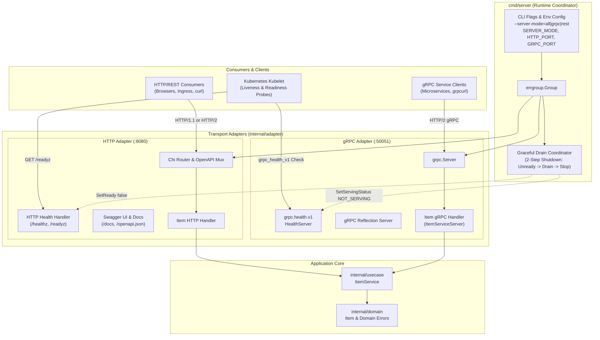
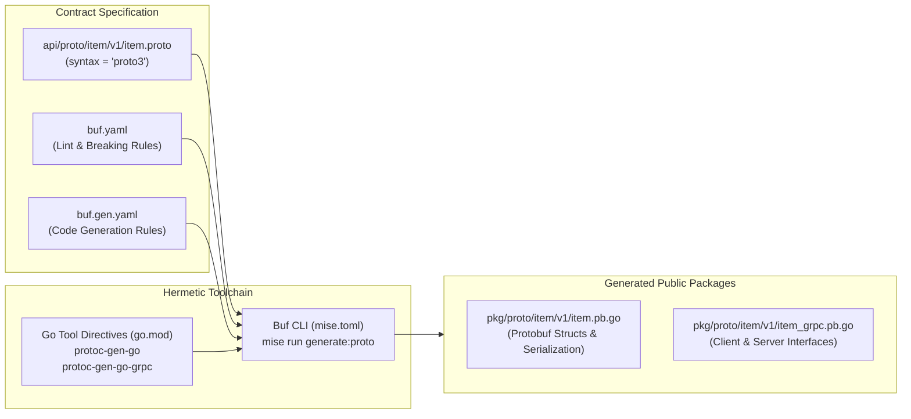
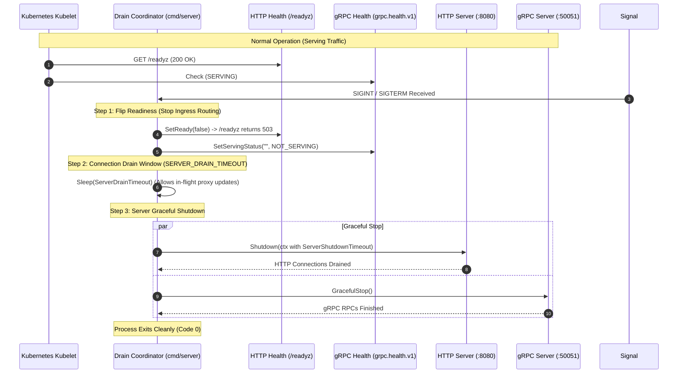
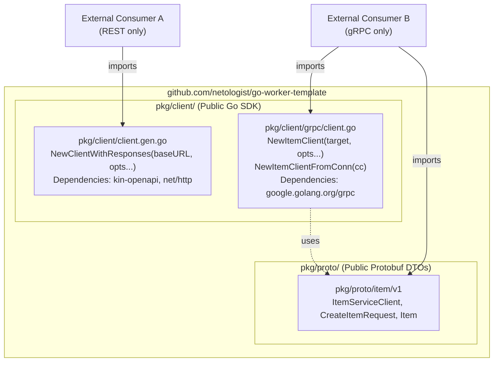
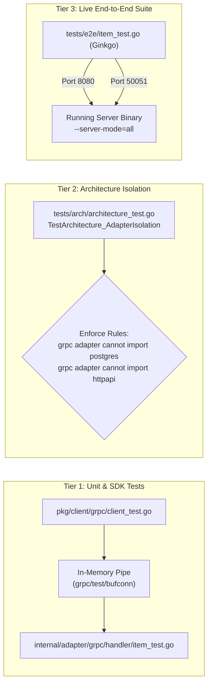

# ADR-0007: gRPC Protocol Support and Dual-Server Architecture

## Status
Accepted

## Date
2026-10-11

## Context
The service currently exposes its operations exclusively over HTTP/REST using an OpenAPI 3.0 specification-first design (ADR-0002) served via Chi. While this model provides broad accessibility, built-in Swagger UI documentation, and JSON interoperability, modern distributed microservice topologies require high-performance, low-latency, and type-safe inter-service remote procedure calls (RPC).

Integrating gRPC into an existing Go hexagonal service introduces several architectural challenges:

1. **Serving Model & Lifecycle Divergence**:
   Running gRPC must not undermine existing HTTP capabilities (such as `/healthz`, `/readyz`, OpenAPI docs at `/docs`, and existing REST consumers). The runtime must support running both protocols concurrently while preserving Kubernetes zero-downtime graceful shutdown coordination.
2. **Tooling & Hermetic Environment**:
   Standard gRPC compilation frequently relies on system-installed C++ `protoc` binaries, violating the hermetic, zero-global-dependency development environment established in ADR-0001.
3. **Public SDK & Package Encapsulation**:
   External clients require programmatic Go SDKs for both REST and gRPC. Go language rules forbid external packages from importing `internal/` paths. Generated Protobuf models and gRPC client stubs must be publicly consumable without forcing heavy gRPC transitive dependencies onto REST-only consumers.
4. **Error Handling & Layer Invariants**:
   In accordance with ADR-0005 (Layer Simplification and Zero-Ceremony Mapping), transport adapters must directly map shared domain invariants (`domain.ErrInvalidItem`, `domain.ErrItemAlreadyExists`) to protocol-specific status codes without redundant translation layers or duplicate schema validation frameworks.
5. **Architectural Isolation & Testability**:
   Transport adapters (`internal/adapter/httpapi` and `internal/adapter/grpc`) must remain strictly isolated from one another and independently testable via high-speed in-memory conduits (`bufconn`) and end-to-end suites.

---

## Decision

We adopt a **Dual-Protocol Serving Architecture** supporting concurrent HTTP/REST and gRPC servers backed by **Buf CLI** code generation, **`grpc.health.v1`** lifecycle synchronization, and decoupled client packages under `pkg/client/`.

### 1. Overall Dual-Protocol Architecture

The service coordinates both HTTP and gRPC transport layers within `cmd/server/main.go` using `golang.org/x/sync/errgroup`:



- **Default Execution Mode**: `--server-mode=all` (both protocols run concurrently).
- **Alternative Modes**: `--server-mode=grpc` (gRPC only) or `--server-mode=rest` (HTTP/REST only).
- **Environment Variables**: Overridable via `SERVER_MODE`, `HTTP_PORT` (default `8080`), and `GRPC_PORT` (default `50051`).

---

### 2. Specification-First Protobuf Tooling Pipeline (Buf CLI)

Protobuf compilation is managed via **Buf CLI** pinned in `mise.toml` to prevent any requirement for system-installed `protoc` binaries:



- **Specification Location**: `api/proto/item/v1/item.proto`.
- **Generated Target**: `pkg/proto/item/v1/`.
- **Generation Command**: `mise run generate:proto` (integrated into composite `mise run generate`).

---

### 3. Graceful Shutdown & Health Synchronization

To guarantee zero dropped requests during rolling Kubernetes upgrades, HTTP and gRPC readiness states are linked into a synchronized two-step drain cycle:



---

### 4. Zero-Ceremony Domain Mapping & Status Codes

Following ADR-0005, the gRPC handler directly consumes `usecase.ItemService` and maps canonical domain errors into standard gRPC status codes (`google.golang.org/grpc/codes`):

```mermaid
graph TD
    Request["gRPC Request<br/>(CreateItemRequest)"] --> Handler["internal/adapter/grpc/handler<br/>ItemHandler.CreateItem"]
    Handler --> Service["internal/usecase<br/>ItemService.CreateItem(ctx, name, desc, price)"]
    Service --> DomainCheck{"Domain Invariants<br/>(domain.NewItem)"}

    DomainCheck -->|ErrInvalidItem| Invalid["codes.InvalidArgument<br/>(status.Errorf)"]
    DomainCheck -->|ErrItemAlreadyExists| Conflict["codes.AlreadyExists<br/>(status.Errorf)"]
    DomainCheck -->|Unexpected DB Error| Internal["codes.Internal<br/>('internal server error' + slog.Error)"]
    DomainCheck -->|Success (domain.Item)| Success["codes.OK<br/>(toProtoItem -> CreateItemResponse)"]

    Invalid --> Client["gRPC Caller"]
    Conflict --> Client
    Internal --> Client
    Success --> Client
```

| Domain Error / Condition | HTTP REST Status | gRPC Status Code | Rationale |
| :--- | :--- | :--- | :--- |
| `domain.ErrInvalidItem` | `400 Bad Request` | `codes.InvalidArgument` | Caller provided malformed payload or violated entity invariants. |
| `domain.ErrItemAlreadyExists` | `409 Conflict` | `codes.AlreadyExists` | Resource with identical natural key already exists. |
| `domain.ErrItemNotFound` | `404 Not Found` | `codes.NotFound` | Target entity does not exist in the persistence store. |
| Unhandled / Persistence Errors | `500 Internal Server Error` | `codes.Internal` | Unexpected server failure; sensitive trace logged to `slog`, masked to client. |

---

### 5. Decoupled Public Client SDK (`pkg/client`)

To prevent dependency bloat for external API consumers, the public SDK isolates HTTP and gRPC implementations into separate subpackages:



- **REST Clients**: Import `github.com/netologist/go-worker-template/pkg/client` (zero gRPC imports).
- **gRPC Clients**: Import `github.com/netologist/go-worker-template/pkg/client/grpc` and `pkg/proto/item/v1`.

---

### 6. Verification and Test Architecture

The gRPC implementation is verified across three testing tiers:



- **In-Memory Speed (`bufconn`)**: Unit and client SDK tests run in milliseconds without opening local OS network sockets.
- **CI Contract Drift (`validate-proto`)**: GitHub Actions runs `buf generate` and validates `git diff --exit-code -- pkg/proto/`.
- **E2E Ginkgo Suite**: Exercises both live ports concurrently with PostgreSQL persistence.

---

## Consequences

### Positive
- **High-Performance RPC**: Enables low-latency, binary Protobuf inter-service communication with streaming readiness.
- **Zero-Downtime Reliability**: Standard `grpc.health.v1` integrates seamlessly with Kubernetes gRPC health probes and the existing graceful shutdown drain coordinator.
- **Hermetic Toolchain**: Zero system-level dependencies; version-pinned via `mise.toml` (`buf`) and `go.mod` `tool` directives.
- **Isolated Public SDK**: Consumers importing REST do not pull in heavy gRPC dependencies, and vice versa.
- **Zero-Ceremony Code Reuse**: Core usecase and domain logic (`internal/usecase`, `internal/domain`) are 100% reused across HTTP and gRPC without duplicate validation or DTO ceremony.

### Negative
- **Expanded Surface Area**: Requires maintaining both `api/openapi.yaml` and `api/proto/item/v1/item.proto` as contracts.
- **Dual Runtime Management**: `cmd/server/main.go` coordinates two listening server loops and failure channels in parallel.

### Neutral
- Service engineers must run both `mise run generate:oapi` and `mise run generate:proto` (or composite `mise run generate`) when adding new domain operations.

---

## Alternatives Considered

1. **Single-Port Multiplexing (`cmux`)**:
   - *Rejected*: Running HTTP/1.1 and gRPC over the same port adds connection inspection latency, complicates TLS termination, and creates hard-to-debug HTTP/2 multiplexing edge cases.
2. **Mutually Exclusive Single Mode Only (`--grpc` XOR `--rest`)**:
   - *Rejected*: In production Kubernetes environments, disabling HTTP completely breaks existing HTTP ingress, Prometheus scrapers, and Swagger UI endpoints. Dual-serving is the cloud-native standard.
3. **Protobuf-Level Validation (`protovalidate`)**:
   - *Rejected*: Violates ADR-0005. Domain models already enforce business invariants; duplicating validation rules inside `.proto` files creates contract drift and unnecessary external library dependencies.
4. **Generating Protobuf Code into `internal/gen/grpc`**:
   - *Rejected*: Go's `internal` visibility prevents `pkg/client` and external consumers from importing generated Protobuf messages and client stubs.

---

## References
- ADR-0001: Standardized Development Environment and Tooling Pipeline
- ADR-0002: OpenAPI Specification-First Architecture with oapi-codegen and Chi
- ADR-0004: Configuration Management Architecture with caarlos0/env
- ADR-0005: Layer Simplification and Zero-Ceremony Mapping Architecture
- [Buf CLI Documentation](https://buf.build/docs)
- [gRPC Health Checking Protocol](https://github.com/grpc/grpc/blob/master/doc/health-checking.md)
- [Kubernetes gRPC Liveness/Readiness Probes](https://kubernetes.io/docs/tasks/configure-pod-container/configure-liveness-readiness-startup-probes/#define-a-grpc-liveness-probe)
