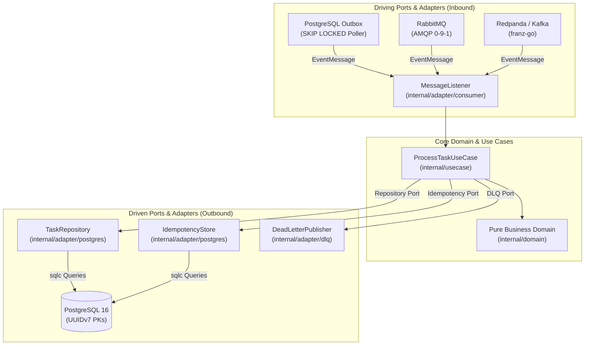

# Go Worker Template

A production-grade, battle-tested Go background worker and asynchronous event processor template built with **Hexagonal Architecture** (ports & adapters), pluggable message listeners (**PostgreSQL Outbox**, **RabbitMQ**, **Redpanda / Apache Kafka**), concurrency worker pools, atomic idempotency deduplication, poison pill / dead letter queue (DLQ) routing, isolated health probes (`/livez`, `/readyz`), hermetic toolchains (**Mise**), and a **zero-trust CI/CD pipeline**.

---

## Key Architectural Highlights



- **Pluggable Event Ingestion**: Unified `MessageListener` abstraction supporting PostgreSQL Outbox (`SKIP LOCKED`), RabbitMQ (AMQP 0-9-1), and Redpanda / Apache Kafka (`franz-go`) with automatic panic recovery.
- **Atomic Idempotency Deduplication**: Outbound `IdempotencyStore` guarantees exact-once execution semantics across distributed consumers.
- **Poison Pill & DLQ Routing**: Differentiates transient errors (`ErrTransient` $\to$ NACK / exponential backoff) from fatal errors / poison pills (`ErrFatal` $\to$ Dead Letter Queue).
- **Hermetic Toolchains**: Reproducible developer environments and CI pipelines managed strictly through `mise` and Go tool directives—zero ambient dependency drift.
- **Type-Safe Persistence**: Pure SQL compilation with `sqlc`, versioned migrations with `goose`, high-performance connection pooling with `pgx/v5`, and time-ordered `UUIDv7` keys.
- **Zero-Trust CI/CD**: Gitleaks secret detection, govulncheck vulnerability audits, actionlint and zizmor workflow analysis, and minimal scratch production containers.
---

## Documentation Roadmap

| Section | Description |
| :--- | :--- |
| **[Folder Structure](folder-structure.md)** | Deep dive into hexagonal layers, dependencies, and file layout. |
| **[Tech Stack](tech-stack.md)** | Architectural justification for every library and developer tool. |
| **[CI/CD & Security](pipeline.md)** | Multi-stage verification pipeline, container provenance, and supply chain security. |
| **[Template Guide](template-guide.md)** | Step-by-step guide to instantiating, renaming, and adopting this template. |
| **[User Guide](user-guide.md)** | Comprehensive developer handbook for running, debugging, testing, and operating the service. |
| **[Decisions (ADRs)](decisions/0001-development-environment.md)** | Formal Architecture Decision Records documenting all major technical tradeoffs. |
| **[Technical Debts](techdebts/0001-ci-cache-poisoning.md)** | Explicit log of tracked technical compromises and their remediation paths. |

---

## Quickstart

### Prerequisites

- [Mise](https://mise.jdx.dev/) (manages Go runtime and dev tools)
- [Docker](https://docs.docker.com/get-docker/) & Docker Compose

### Running Locally

```bash
# 1. Install toolchain via mise
mise install

# 2. Copy the environment configuration template
cp .env.example .env

# 3. Start PostgreSQL, RabbitMQ, and Redpanda dependencies
mise run docker:compose-up
mise run migrate:up

# 4. Run worker process with live-reload (Air)
mise run dev
```

The worker starts processing asynchronous events and exposes lightweight health probes on port `8081`:

- **Liveness probe**: `GET http://localhost:8081/livez`
- **Readiness probe**: `GET http://localhost:8081/readyz`
