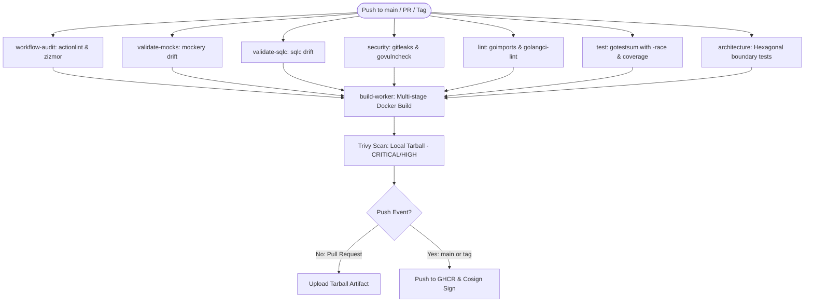

# CI/CD & Security Pipeline Reference

This document details the continuous integration, continuous delivery (CI/CD), and software supply chain security architecture implemented in `.github/workflows/ci.yml`.

---

## 1. Pipeline Principles & Security Philosophy

The CI pipeline is designed around **Zero-Trust**, **Least Privilege**, and **Shift-Left Security**:

1. **Default Read-Only Permissions**: The workflow sets `permissions: contents: read` globally. Elevated privileges (e.g. `packages: write`, `id-token: write`) are granted strictly to specific jobs that require them.
2. **Concurrency Control**: Running jobs on the same branch/PR are automatically cancelled when a new commit arrives (`concurrency.cancel-in-progress: true`), saving GitHub Actions runner minutes.
3. **Drift-Free Code Generation**: Ensures that SQL queries and test mocks committed to Git are 100% in sync with their source definitions.
4. **Supply Chain Integrity**: Every published production image is built from `scratch`, scanned rootlessly for vulnerabilities via Trivy, signed keylessly via Cosign with OIDC, and attested with SLSA v1 provenance.

---

## 2. Pipeline Execution Flow



---

## 3. Job-by-Job Breakdown

### 3.1. `workflow-audit`
- **Goal**: Prevent pipeline misconfigurations, injection attacks, and workflow syntax errors.
- **Tools**:
  - `actionlint`: Static checker for GitHub Actions workflow files (verifies expressions, runner types, and context usage).
  - `zizmor`: Security auditor for GitHub Actions, detecting overly permissive tokens, script injection vulnerabilities, and untrusted checkouts.

### 3.2. Generator Drift Checks (`validate-mocks`, `validate-sqlc`)
- **Goal**: Guarantee that generated Go code is never committed out-of-date.
- **Mechanism**:
  1. The runner executes the respective code generator (`mockery`, `sqlc generate`).
  2. Runs `git diff --exit-code <path>`.
  3. If changes are detected, the pipeline fails with an actionable error instructing the developer to run `mise run generate` locally and commit the result.
### 3.3. `security` (Secrets & Vulnerabilities)
- **Gitleaks**: Scans commit history and working tree for leaked API keys, tokens, private certificates, or passwords.
- **Govulncheck**: Official Go vulnerability scanner. Analyzes the call graph of the code against the National Vulnerability Database (NVD) and Go security database, reporting only genuinely reachable vulnerabilities.

### 3.4. `lint` (Code Formatting & Static Analysis)
- **Formatting Verification**: Checks that all Go files comply with `goimports` grouping under the project's module prefix.
- **Smart golangci-lint**:
  - On **Pull Requests**: Runs with `--new-from-rev=origin/$BASE_REF`, linting only changed lines to provide instant feedback and avoid blocking on legacy code.
  - On **Main/Tags**: Runs full scan `./...` across the entire codebase.

### 3.5. `test` (Unit Testing & Race Detection)
- **Flags**: `gotestsum --format testname -- -race -covermode=atomic -coverprofile=coverage.out ./internal/... ./cmd/...`
- **Race Detection**: Detects data races at runtime in concurrent goroutines.
- **Atomic Coverage**: Produces deterministic code coverage reports uploaded as workflow artifacts (retained for 7 days).


### 3.6. `architecture` (Hexagonal Architecture Boundary Enforcement)
- **Goal**: Guarantee zero layer leakage and enforce Hexagonal Architecture dependency directions.
- **Rules Enforced**:
  - `internal/domain` only imports standard library packages and allowed primitives (`uuid`). Absolutely no imports of `usecase`, `adapter`, `config`, `gen`, or message broker/database drivers.
  - `internal/usecase` only imports `domain`. No imports of outer adapters (`consumer`, `postgres`, `dlq`, `probe`), `config`, or `cmd`.
  - Driving (`consumer`, `probe`) and driven (`postgres`, `dlq`) adapters never cross-import each other.
  - `internal/config` never imports `domain`, `usecase`, or `adapter`.

### 3.7. `build-worker` (Build, Scan & Supply Chain Security)
- **Stage 1: Multi-stage Docker Build**:
  - Builder image compiles the static binary with CGO disabled (`CGO_ENABLED=0`) and stripped debug tables (`-ldflags="-s -w"`).
  - Production image is created `FROM scratch` with only `/etc/ssl/certs/ca-certificates.crt`, non-root `/etc/passwd`, and the binary.
- **Stage 2: Rootless Trivy Scan**:
  - The image is exported directly to a tarball (`docker save ... -o /tmp/worker-image.tar`).
  - Trivy executes against the tarball file without mounting `/var/run/docker.sock`, preventing privilege escalation on the CI runner.
  - Fails the build if any `CRITICAL` or `HIGH` vulnerabilities are found.
- **Stage 3: Conditional Push & Signing (Main/Tags only)**:
  - On Pull Requests, the image is never pushed to the registry (only saved as an internal artifact for E2E runs).
  - On merge to `main` or semver tags, the image is pushed to GitHub Container Registry (`ghcr.io`).
  - **Cosign Keyless Signing**: Uses GitHub OIDC identity tokens to cryptographically sign the image digest.
  - Generates SLSA v1 provenance and GitHub SBOM attestations.

---

## 4. Documentation Pipeline & Enabling GitHub Pages

This repository includes a dedicated documentation pipeline (`.github/workflows/docs.yml`) that compiles the MkDocs Material documentation site and deploys it using modern, tokenless GitHub Actions artifact deployment.

### 4.1. How to Enable GitHub Pages on GitHub

To activate automated documentation publishing for your repository:

1. **Navigate to Repository Settings**:
   - Open your repository on GitHub.
   - Click on the **Settings** tab in the top navigation bar.

2. **Open Pages Configuration**:
   - In the left sidebar, scroll down to the **Code and automation** section.
   - Click on **Pages**.

3. **Select GitHub Actions as the Build Source**:
   - Under **Build and deployment** $\rightarrow$ **Source**, open the dropdown.
   - Select **GitHub Actions** (do **not** select "Deploy from a branch").
   - *Note*: You do not need to configure a new workflow from GitHub's starter list; our `.github/workflows/docs.yml` is already configured and recognized automatically.

4. **Repository Visibility & GitHub Plan Requirements**:
   - **Public Repositories**: GitHub Pages is free and available on all accounts (including GitHub Free).
   - **Private Repositories**: GitHub requires a paid plan (**GitHub Pro**, **Team**, or **Enterprise**) to host private GitHub Pages sites. If your repository is private on a GitHub Free account:
     - Make the repository public via **Settings** $\rightarrow$ **Danger Zone** $\rightarrow$ **Change repository visibility** $\rightarrow$ **Make public**, or
     - Upgrade your personal account to GitHub Pro or your organization to GitHub Team.
   - *Artifact Fallback*: Even if Pages is not yet enabled or your repository is private on a free plan, the pipeline automatically compiles the site and publishes a 14-day retained `documentation-site` artifact on every workflow run. You can download and inspect the complete HTML site directly from the Actions run summary.

5. **Verify the Deployment**:
   - Once Pages is configured to use GitHub Actions, push a commit to `main` (or manually trigger the workflow via **Actions** $\rightarrow$ **Documentation Pipeline** $\rightarrow$ **Run workflow**).
   - Once completed, your live documentation site URL will be displayed in **Settings** $\rightarrow$ **Pages** and directly on the repository homepage:
     ```text
     https://<owner>.github.io/<repo-name>/
     ```
