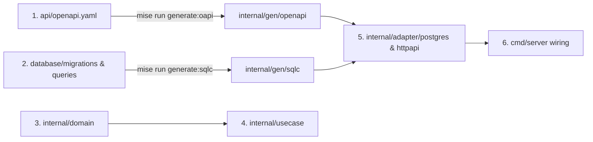

# Template Usage & Adoption Guide

This guide explains how to use this repository as a **Production-Grade Go Service Template** to bootstrap new microservices, REST APIs, or backend platforms.

---

## 1. Quickstart: Instantiating a New Service

### Approach 1: Using `gonew` + `mise run template:init` (Recommended CLI Workflow)

Official Go project instantiation tool combined with our hermetic post-scaffolding alignment:

```bash
# 1. Install gonew (if not already installed)
go install golang.org/x/tools/cmd/gonew@latest

# 2. Scaffold new project directory
gonew github.com/netologist/go-worker-template github.com/your-org/your-service

# 3. Enter project directory and install toolchain
cd your-service
mise install

# 4. Run template:init to align all YAML, TOML, CI and tool configs to your-service
mise run template:init github.com/your-org/your-service
```

### Approach 2: GitHub Web ("Use this template") + `mise run template:init`

1. Navigate to the repository on GitHub and click **Use this template**.
2. Clone your newly created repository locally.
3. Run:
   ```bash
   cd your-service
   mise install
   mise run template:init github.com/your-org/your-service
   ```
---

## 2. Manual Renaming (Alternative)

If you prefer to perform the renaming manually without running the automation task:
### 1. Update `go.mod`
Run the native Go tool:
```bash
go mod edit -module github.com/your-org/your-service
```

### 2. Replace Import Paths in Codebase
Search and replace all instances of `github.com/netologist/go-worker-template` with your new module path:
```bash
# On macOS / Linux:
find . -type f -name "*.go" -not -path "./vendor/*" -exec sed -i '' 's|github.com/netologist/go-worker-template|github.com/your-org/your-service|g' {} +
```

### 3. Update `mise.toml`
Update the module prefix in `format` task and the binary/database names:
```toml
[env]
POSTGRES_DB = "your_service_db"

[tasks."format"]
run = "find . -type f -name '*.go' -not -path './vendor/*' -not -path './internal/gen/*' -exec go tool goimports -local github.com/your-org/your-service -w {} +"

[tasks."docker:build"]
run = "docker build --target production -t your-service:latest ."
```

### 4. Update CI Pipeline (`.github/workflows/ci.yml`)
Update line 175 where `goimports -local` is validated:
```yaml
-local github.com/your-org/your-service
```

---

## 4. Replacing the Reference Domain ("Item") with Your Business Domain

This template includes a fully functional, production-ready reference domain (**Items**) to demonstrate Clean Architecture in practice (Domain Invariants $\to$ Use Case $\to$ HTTP Strict Handlers $\to$ PostgreSQL sqlc $\to$ E2E Tests).

To implement your actual business entity (e.g. `Order`, `User`, `Payment`):



### Step 1: Define API Contract (`api/openapi.yaml`)
1. Open `api/openapi.yaml` and update the title, version, and endpoints for your domain.
2. Generate the Go types and server interfaces:
   ```bash
   mise run generate:oapi
   ```

### Step 2: Define Schema & SQL Queries
1. Create a new Goose migration:
   ```bash
   go tool goose -dir database/migrations create create_your_entity sql
   ```
2. Write the DDL with UUIDv7 primary keys and timestamps.
3. Write your queries in `database/queries/your_entity.sql` with sqlc annotations:
   ```sql
   -- name: CreateEntity :one
   INSERT INTO your_entities (id, name, created_at, updated_at)
   VALUES ($1, $2, NOW(), NOW())
   RETURNING *;
   ```
4. Generate the type-safe Go query code:
   ```bash
   mise run generate:sqlc
   ```

### Step 3: Implement Domain Layer (`internal/domain/`)
1. Create your domain entity and business invariants (e.g., `internal/domain/entity.go`).
2. Define repository and service interfaces (**Ports**).
3. Add domain sentinel errors (`internal/domain/errors.go`).

### Step 4: Implement Application Use Case (`internal/usecase/`)
1. Implement your service interface orchestrating domain operations and calling repository ports.
2. Generate interface mocks for unit tests:
   ```bash
   mise run generate:mocks
   ```

### Step 5: Implement Adapters (`internal/adapter/`)
1. **PostgreSQL Adapter** (`internal/adapter/postgres/`):
   - Implement your repository interface calling `internal/gen/sqlc.Queries`.
   - Map SQL models to domain models.
2. **HTTP API Adapter** (`internal/adapter/httpapi/handler/`):
   - Implement the `StrictServerInterface` methods generated in `internal/gen/openapi`.
   - Map domain errors to RFC 7807 problem details using `problem.New(...)`.

### Step 6: Wire Dependencies in Composition Root (`cmd/server/main.go`)
1. Instantiate your repository with the database pool.
2. Instantiate your use case with the repository.
3. Instantiate your HTTP handler with the use case.
4. Mount the handler into the router via `openapi.HandlerFromMux(...)`.

### Step 7: Verify Everything
```bash
mise run generate
mise run lint
mise run test
mise run test:e2e
```

### Step 8: Enable GitHub Pages Documentation
Follow the [GitHub Pages Configuration Guide](pipeline.md#4-documentation-pipeline-enabling-github-pages) to activate automated documentation hosting for your new service repository.

---

## 5. Summary of Best Practices for Production Services

1. **Keep Domain Independent**: Never import database drivers, HTTP packages, or external frameworks into `internal/domain`.
2. **Always Run Drift Checks**: Before pushing, run `mise run generate` and ensure `git status` shows clean generated files.
3. **Use UUIDv7**: Default to UUIDv7 for all primary keys to maintain fast B-Tree indexing and time-ordered data.
4. **Enforce RFC 7807**: Use `internal/adapter/httpapi/problem` for all HTTP error responses.
5. **Rely on Mise**: Do not install global Go tools; run all commands through `mise run <task>` to ensure reproducibility across teams and CI.
