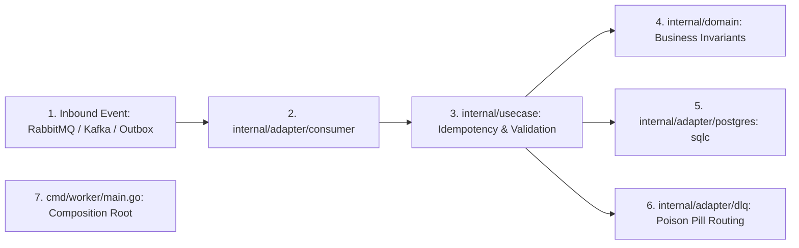

# Template Usage & Adoption Guide

This guide explains how to use this repository as a **Production-Grade Go Worker Template** to bootstrap background event processors, transactional outbox pollers, Kafka/Redpanda stream consumers, RabbitMQ workers, or async job runners.

---

## 1. Quickstart: Instantiating a New Service

### Approach 1: Using `gonew` + `mise run template:init` (Recommended CLI Workflow)

Official Go project instantiation tool combined with our hermetic post-scaffolding alignment:

```bash
# 1. Install gonew (if not already installed)
go install golang.org/x/tools/cmd/gonew@latest

# 2. Scaffold new project directory
gonew github.com/netologist/go-worker-template github.com/your-org/your-worker

# 3. Enter project directory and install toolchain
cd your-worker
mise install

# 4. Run template:init to align all YAML, TOML, CI and tool configs to your-service
mise run template:init github.com/your-org/your-worker
```

### Approach 2: GitHub Web ("Use this template") + `mise run template:init`

1. Navigate to the repository on GitHub and click **Use this template**.
2. Clone your newly created repository locally.
3. Run:
   ```bash
   cd your-worker
   mise install
   mise run template:init github.com/your-org/your-worker
   ```
---

## 2. Manual Renaming (Alternative)

If you prefer to perform the renaming manually without running the automation task:
### 1. Update `go.mod`
Run the native Go tool:
```bash
go mod edit -module github.com/your-org/your-worker
```

### 2. Replace Import Paths in Codebase
Search and replace all instances of `github.com/netologist/go-worker-template` with your new module path:
```bash
# On macOS / Linux:
find . -type f -name "*.go" -not -path "./vendor/*" -exec sed -i '' 's|github.com/netologist/go-worker-template|github.com/your-org/your-worker|g' {} +
```

### 3. Update `mise.toml`
Update the module prefix in `format` task and the binary/database names:
```toml
[env]
POSTGRES_DB = "your_worker_db"

[tasks."format"]
run = "find . -type f -name '*.go' -not -path './vendor/*' -not -path './internal/gen/*' -exec go tool goimports -local github.com/your-org/your-worker -w {} +"

[tasks."docker:build"]
run = "docker build --target production -t your-worker:latest ."
```

### 4. Update CI Pipeline (`.github/workflows/ci.yml`)
Update line 175 where `goimports -local` is validated:
```yaml
-local github.com/your-org/your-worker
```

---

## 3. Replacing the Reference Domain ("Task") with Your Business Domain

This template includes a fully functional, production-ready reference domain (**Tasks**) to demonstrate Clean Hexagonal Architecture in an asynchronous processing environment (Event Message $\to$ Consumer Listener $\to$ Idempotency Gate $\to$ Use Case $\to$ Domain Invariants $\to$ PostgreSQL Persistence / DLQ Routing).

To implement your actual business entity (e.g. `OrderProcessing`, `NotificationDispatch`, `DataSync`):



### Step 1: Define Domain Models & Ports (`internal/domain/`)
1. Update or replace `internal/domain/task.go` with your business entity and domain invariants.
2. Define repository and publisher ports (`internal/domain/ports.go`).
3. Declare domain sentinel errors (`internal/domain/errors.go`) separating `ErrTransient` (retryable) from fatal errors.

### Step 2: Define Schema & SQL Queries
1. Create a new Goose migration:
   ```bash
   go tool goose -dir database/migrations create create_your_entity sql
   ```
2. Write DDL with UUIDv7 primary keys and timestamps.
3. Write SQL queries in `database/queries/your_entity.sql` with sqlc annotations.
4. Generate type-safe Go query code:
   ```bash
   mise run generate:sqlc
   ```

### Step 3: Implement Application Use Case (`internal/usecase/`)
1. Implement `domain.TaskProcessor` in your use case, orchestrating atomic idempotency (`idempotencyStore.TryAcquire`), validation, persistence, and DLQ handling.
2. Regenerate interface mocks for unit tests:
   ```bash
   mise run generate:mocks
   ```

### Step 4: Configure Inbound Broker Adapter (`internal/adapter/consumer/`)
Choose or combine your inbound consumers:
- **PostgreSQL Outbox Poller** (`internal/adapter/consumer/outbox`): Uses `FOR UPDATE SKIP LOCKED` for transactional polling.
- **RabbitMQ AMQP 0-9-1** (`internal/adapter/consumer/rabbitmq`): Subscribes to queues with prefetch and ACK/NACK routing.
- **Redpanda / Apache Kafka** (`internal/adapter/consumer/kafka`): Consumes topic partitions using consumer groups with offset management.

### Step 5: Wire Dependencies in Composition Root (`cmd/worker/main.go`)
1. Instantiate the chosen listener based on `cfg.BrokerKind`.
2. Wire repositories, idempotency store, and DLQ publisher into your use case.
3. Register health probe checks (`/livez`, `/readyz`).
4. Execute the worker pool with graceful drain support.

### Step 6: Verify Everything
```bash
mise run generate
mise run lint
mise run test
```

### Step 7: Enable GitHub Pages Documentation
Follow the [GitHub Pages Configuration Guide](pipeline.md#4-documentation-pipeline-enabling-github-pages) to activate automated documentation hosting for your new worker repository.
```bash
mise run generate
mise run lint
mise run test
mise run test:e2e
```

### Step 8: Enable GitHub Pages Documentation
Follow the [GitHub Pages Configuration Guide](pipeline.md#4-documentation-pipeline-enabling-github-pages) to activate automated documentation hosting for your new service repository.

---

## 5. Summary of Best Practices for Production Services

1. **Keep Domain Independent**: Never import database drivers, HTTP packages, or external frameworks into `internal/domain`.
2. **Always Run Drift Checks**: Before pushing, run `mise run generate` and ensure `git status` shows clean generated files.
3. **Use UUIDv7**: Default to UUIDv7 for all primary keys to maintain fast B-Tree indexing and time-ordered data.
4. **Enforce RFC 7807**: Use `internal/adapter/httpapi/problem` for all HTTP error responses.
5. **Rely on Mise**: Do not install global Go tools; run all commands through `mise run <task>` to ensure reproducibility across teams and CI.
